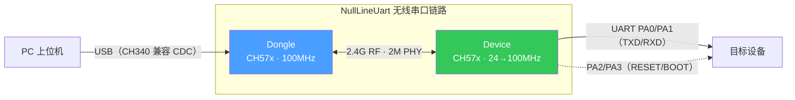
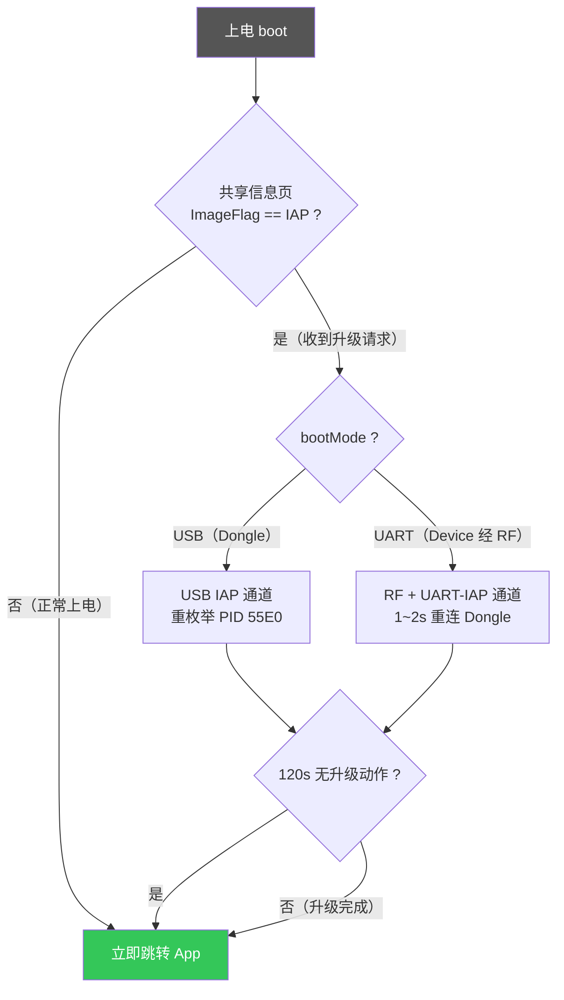

# NullLineUart —— 基于CH57x 的2.4G 无线串口

NullLineUart 是一套基于 CH57x 的 2.4G 无线串口方案：用一对小硬件替代串口线，让 PC 与远端设备之间像插了一根透明串口线一样双向收发数据，无需关心传输细节。

硬件分两端——插在 PC USB 口的 **Dongle**（枚举为 CH340 虚拟串口，免驱动）和接在目标设备串口上的 **Device**；两端上电自动配对，之后数据经 2.4G 链路透明透传。工程同时内置免按键 IAP 升级通路：COM 口发送一条魔数即可进入 boot 完成固件升级。

## 功能特性

- **双向透明传输**：PC COM ↔ 2.4G ↔ 目标设备串口，无需关心帧格式
- **CH340 兼容**：Dongle 枚举为 CH340（VID `1A86` / PID `7523`），免驱动（Windows 自带 CH340 驱动即可）
- **串口参数透传**：PC 侧修改波特率/数据位/停止位/校验，经 RF 同步到 Dev 侧串口（默认 115200，可根据上位机设置自动调整）
- **自动配对**：Dongle 与 Dev 上电自动发现并绑定，绑定信息保存在 Flash，掉电不丢
- **免按键 IAP 升级**：COM 口发 8 字节魔数进 boot；Dongle 走 USB 通道，Dev 经 Dongle 透传走 RF+串口通道，无需按复位/BOOT 键
- **固件版本信息**：构建时自动注入语义版本号 + git 哈希 + 提交日期，可离线查询

## 系统架构



## 硬件平台

### MCU 规格

| 项目 | 说明 |
|---|---|
| 型号 | WCH CH57xQ 系列（CH570Q / CH572Q） |
| 内核 | 32-bit RISC-V（rv32imc + 自定义扩展） |
| 主频 | 最高 100MHz（外部 32MHz 晶振 → 600MHz PLL 分频） |
| Flash | 240KB（代码区 236K + 末尾 4K 共享信息页） |
| RAM | 12KB |
| USB | 内置 USB Device（Dongle 枚举 + boot IAP 通道） |
| 射频 | 内置 2.4G 收发器（RF 库 `libCH57xRF.a`） |
| 晶振 | 外部 32MHz HSE（负载电容配置 `HSECap_12p`） |

### 引脚分配

**Dongle（PC 侧）**

| 引脚 | 功能 |
|---|---|
| USB DP/DM | USB 设备（CH340 兼容，PID `7523`；进 IAP 后重枚举为 PID `55E0`） |
| PA7 | LED 指示 |
| PA3 | UART0 TXD，调试打印（仅 Debug/RelWithDebInfo 构建输出） |

**Device（设备侧）**

| 引脚 | 功能 |
|---|---|
| PA0 | UART0 TXD → 目标设备 RX |
| PA1 | UART0 RXD ← 目标设备 TX |
| PA2 | RESET 控制（ST 一键下载功能，默认开启） |
| PA3 | BOOT 控制（ST 一键下载功能，默认开启） |
| PA7 | LED 指示 |

> DTR/RTS 功能默认关闭（`uart_bridge.h` 的 `DTR_RTS_FUNC = FALSE`）；如需用 DTR/RTS 代替 RESET/BOOT，修改该宏。

### 时钟配置

| 固件 | 运行时钟 | 说明 |
|---|---|---|
| Dongle | 100MHz | 上电固定 |
| Boot | 100MHz | 上电固定 |
| Device | 24MHz，动态切 100MHz | 对端波特率在 400k~1M 区间时切 100MHz 保证高波特率采样精度 |

### 射频参数

| 项目 | 值 |
|---|---|
| 频段 | 2.4G ISM，默认通信频点 17 |
| PHY | 2M（`CONN_PHY_TYPE`） |
| 连接参数 | accessAddr / channel / interval 由配对时协商生成 |
| 配对标识 | 8 字节芯片唯一 ID（`GET_UNIQUE_ID`），保存在共享信息页 |

### LED 指示

| 状态 | LED 行为 |
|---|---|
| 未配对 | 快闪（200ms 周期） |
| 已配对(空闲状态)  | 常灭 |
| 已配对(有数据收发)| 随数据收发频率闪烁 |
| 处于 IAP boot | 常亮 |

## 仓库结构

| 目录/文件 | 说明 |
|---|---|
| `Core/` | 三个固件入口：`Main_boot.c` / `Main_dongle.c` / `Main_dev.c` |
| `Bsp/` | 工程应用层：RF 协议状态机、串口桥、USB、IAP、LED、配对信息、版本信息 |
| `StdPeriphDriver/` | WCH 官方外设库（含 `libISP572.a`、`libCH57xRF.a` 预编译库） |
| `cmake/` | 工具链文件 `riscv-wch-elf-gcc.cmake`、版本模板 `version.h.in` |
| `cmakelists.txt` | 根构建脚本（版本号、三个固件目标、后处理） |
| `CMakePresets.json` | 构建预设（配置 + 构建一体） |
| `Link.ld` / `Link_boot.ld` | App / Boot 链接脚本 |
| `startup_CH572.S` | 启动文件 |
| `build/` | 构建输出（不入库） |

## 固件 Flash 布局

| 区域 | 地址 | 说明 |
|---|---|---|
| IAP boot（dongle/dev 共用同一镜像） | 0x0000 ~ 0x8000 | 读共享信息页判断进 IAP 还是跳 app |
| App | 0x8000 ~ 0x3B000 | Dongle/Device 应用 |
| 共享信息页 | 0x3B000（末尾 4K） | 配对信息 + IAP 标志 + 升级通道 |

上电 boot 先跑，决策流程：



> 共享信息页所有写操作均为"读-改-写"（`sys_info.c`），配对信息与 IAP 标志互不覆盖。

## 构建

### 环境依赖

| 工具 | 版本要求 | 说明 |
|---|---|---|
| CMake | ≥ 4.2 | `cmakelists.txt` 声明的最低版本 |
| Ninja | 任意近期版本 | Preset 使用 Ninja 生成器 |
| riscv-wch-elf-gcc | RISC-V Embedded GCC12|下载[MRS2安装包](https://file-oss.mounriver.com/upgrade/MounRiver_Studio_Setup_V2.5.0.zip?sign=9843d9cd161f52ea81b22be73fb9c132&time=1a146491892&from=119.136.112.152&resId=2071891610158804994)，直接解压并提取出`RISC-V Embedded GCC12.7z`,将其解压到一个指定路径，将路径加入 PATH|
| Git | 任意 | 可选；用于把提交哈希注入版本信息 |

### 配置与编译

构建步骤，以 `riscv-relwithdebinfo` 为例：
```bat
:: 按 preset 配置（生成 build/<preset>/）
cmake --preset riscv-relwithdebinfo

:: 构建
cmake --build build/riscv-relwithdebinfo
```

可用 Preset（配置与构建同名）：

| Preset | 构建类型 | 用途 |
|---|---|---|
| `riscv-release` | Release | **发布烧录** |
| `riscv-relwithdebinfo` | RelWithDebInfo | 带调试符号 + 串口打印（日常开发推荐） |
| `riscv-minsizerel` | MinSizeRel | 体积优化 |

### 构建产物（`build/riscv-relwithdebinfo/`）

| 文件 | 用途 |
|---|---|
| `NullLineUart_Dongle.hex(.bin)` / `NullLineUart_Device.hex(.bin)` | **boot+app 合并镜像，直接烧录或者用作 IAP 升级** |
| `NullLineUart_Dongle_app.hex` / `NullLineUart_Device_app.hex` | 仅 App（起始 0x8000），仅供 IAP 工具升级 |
| `*.elf` / `*.map` / `*.lst` | 调试符号 / 链接映射 / 反汇编清单 |

### 版本信息

- **版本号唯一来源**：根 `cmakelists.txt` 的 `project(... VERSION x.y.z)`，升版本只改这一行；
- 构建时自动生成 `build/<preset>/generated/version.h`，宏包括 `FW_VERSION`、`FW_GIT_HASH`、`FW_GIT_DESC`、`FW_COMMIT_DATE`、`FW_VERSION_FULL`；
- 提交 / 暂存 git 变化后重新构建会自动刷新哈希，日常改代码不会触发全量重编；非 git 环境降级为 `nogit/unknown`；
- 版本串 `1.0.0 (<哈希>, <提交日期>)` 已烧入三个固件二进制，离线查询：

```powershell
riscv-wch-elf-strings build/riscv-relwithdebinfo/NullLineUart_Dongle.elf | Select-String -SimpleMatch "1.0.0 ("
```

- Debug / RelWithDebInfo 构建下，Dongle 上电还会从调试口（PA3，115200）打印 `Version Info: ...`。

## 硬件准备

本仓库只包含固件代码，硬件设计文件开源在立创开源硬件平台：

- 开源工程：[无线串口工具](https://oshwhub.com/lkvc/project_aegmuwsk)

制作一套（**需要两块**：Dongle + Device）的最短路径：

1. 打开上述立创工程 → 克隆到自己的嘉立创 EDA 账号 → 校对设计图后下单打样（嘉立创 PCB/SMT，或自行焊接）；
2. 按工程 BOM 备料焊接（主控为 CH57x 系列 CH570 / CH572，二者引脚兼容、固件通用）；

> 板上各引脚与 LED 的对应关系见上文 [硬件平台 · 引脚分配](#引脚分配)或实际电路

## 烧录

1. 打开烧录工具（WCH 官方工具 / MounRiver Studio 均可），选择对应固件的 **合并镜像** `.hex/.bin`（含 boot + app）；
2. 烧录完成后重新上电：boot 读共享信息页 → 非 IAP 标志 → 直接跳 App，行为与正常运行一致；
3. 验证：Dongle 插 PC 应枚举出 CH340 COM 口，LED闪烁，DEVICE上电后与Dongle配对，LED熄灭，有数据传输时LED随数据闪烁。

## 使用说明

### 首次配对

Dongle 与 Dev 上电即自动配对，无需手动操作：

1. 两端就近上电（首次配对要求信号强度 **$RSSI > -35 dBm$**，请靠近放置）；
2. Dev 周期性发送绑定请求（断连后按 `ADV_INTERVAL` 间隔重发），Dongle **自身未绑定**且信号满足 $RSSI > -35 dBm$ 时接受并暂存；
3. 绑定信息（对端 8 字节唯一 ID）写入共享信息页，LED 由快闪转为随数据闪（无数据传输时熄灭）；
4. 之后上电只认已绑定的对端 ID，其他设备的绑定请求会被拒绝（防串台）。

> 重新配对：需先清掉一侧的绑定信息（用烧录工具**整片擦除**后重新烧录合并镜像），再重复上述步骤；仅覆盖烧录 App 区不一定清除共享信息页。

### 串口参数

- PC 侧 COM 口默认 **115200 8N1**；
- 在 PC 侧修改波特率 / 数据位 / 停止位 / 校验位，Dongle 会经 RF 把参数同步给 Dev，Dev 侧 UART 同步生效（`OPCODE_BSP` 通道）；
- 波特率 > 400kbps 时 Dev 自动将系统时钟切到 100MHz 保证采样精度。

### LED 状态速查

| LED | 含义 |
|---|---|
| 快闪（200ms 周期） | 未配对 / 正在连接 |
| 短暂常亮 | 有数据收发 |
| 常亮 | 处于 IAP boot（升级模式） |
| 灭 | 无活动 |

## IAP 升级

**前置条件**：

- 官方工具 `WCHMcuIAP_WinAPP.exe`；
- 升级文件用构建产物中的 **`*_app.hex`**（app-only）,若升级文件用合并的（boot+app）镜像，需指定 **App 起始地址 0x8000**。
- 升级device 需先配对成功（LED 非快闪）。
- 进 boot 的魔数（COM 口以十六进制发送，共 8 字节）：

| 升级目标 | 魔数（十六进制） | 说明 |
|---|---|---|
| Dongle | `1B 49 41 50 44 4C 47 1B` | ESC `IAPDLG` ESC → 进 **USB** 升级**Dongle** |
| Device | `1B 49 41 50 44 45 56 1B` | ESC `IAPDEV` ESC → 经 dongle 透传，进 **RF+串口** 升级**Device** |

### Dongle 升级（USB 接口）

1. 串口工具打开 dongle 的 COM 口，发送魔数 `1B494150444C471B`；
2. dongle 掉线后重枚举为 PID `55E0`的USB设备（设备管理器可见,LED灯常亮）；
3. `WCHMcuIAP` 选 **USB 接口** → 扫描到设备 → 加载 `NullLineUart_Dongle.bin` → 填写目标地址`0x8000` → 下载；
4. 成功后 dongle 自动跳回 app，COM 口恢复。

### Device 升级（串口接口，经 dongle 透传）

1. 确保 dongle 与 dev 已配对（LED 非快闪）；
2. 串口工具打开 dongle 的 COM 口，发送魔数 `1B4941504445561B`；
3. dev 进 boot（LED 常亮），约 1~2s 重连 dongle；
4. 关闭串口工具占用的 COM 口；
5. `WCHMcuIAP` 选 **串口接口** → 同一 COM 口、波特率 115200 → 加载 `NullLineUart_Device.bin` → 填写目标地址`0x8000` → 下载；
5. 成功后 dev 自动跳回 app 并重新配对。

> boot 内置 120s 无升级动作超时：超时后自动跳回 app，不会卡在升级模式。

## 已知限制

- 魔数为 8 字节特定序列；若透传的设备数据中恰含该序列，可能误触发进 boot（概率极低）；
- 首次配对要求 $RSSI > -35 dBm$，两端需就近放置；绑定后按链路实际距离使用（以通信稳定为准）；

